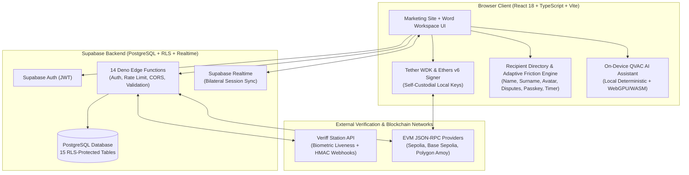
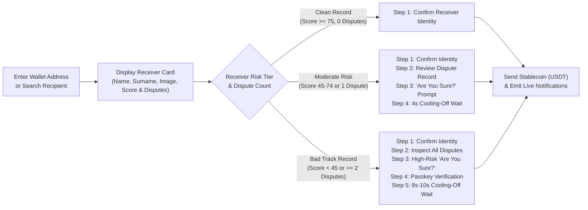
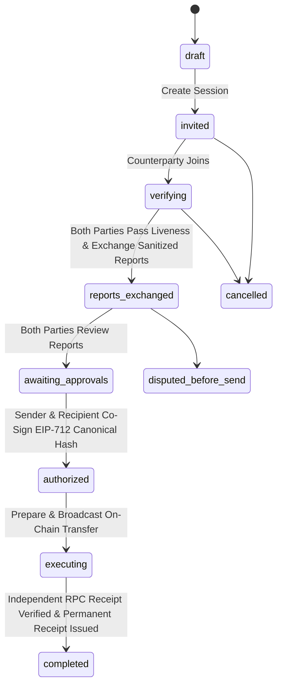

# Word — Trust Every Transaction

**Word** is a trust-first, self-custodial peer-to-peer stablecoin (`USDT`) payment and bilateral accountability platform. It combines **self-custodial wallet infrastructure (Tether WDK)**, **recipient identity & track-record discovery**, **risk-adaptive pre-send verification friction**, **bilateral facial liveness & EIP-712 co-signing (Mutual Trust)**, **on-device AI risk intelligence (QVAC)**, and **cryptographically bound payment agreements and dispute records**.

---

## Table of Contents

1. [Executive Summary](#1-executive-summary)
2. [Business Case & Market Problem](#2-business-case--market-problem)
3. [Product Vision, Target Segments & Business Model](#3-product-vision-target-segments--business-model)
4. [Core Product Flows & User Journey](#4-core-product-flows--user-journey)
   - [4.1 Hardened Sign-Up & Owner Face Scan Pre-Enrollment](#41-hardened-sign-up--owner-face-scan-pre-enrollment)
   - [4.2 Self-Custodial & Profile-Linked Wallet Setup](#42-self-custodial--profile-linked-wallet-setup)
   - [4.3 Recipient Search, Receiver Confirmation & Risk-Adaptive Friction](#43-recipient-search-receiver-confirmation--risk-adaptive-friction)
   - [4.4 Bilateral Mutual Trust Verification & EIP-712 Co-Signing](#44-bilateral-mutual-trust-verification--eip-712-co-signing)
   - [4.5 On-Chain Stablecoin Settlement, Live Notifications & Dispute Vault](#45-on-chain-stablecoin-settlement-live-notifications--dispute-vault)
5. [Technical Architecture](#5-technical-architecture)
   - [5.1 High-Level System Architecture](#51-high-level-system-architecture)
   - [5.2 Adaptive Pre-Send Friction Pipeline](#52-adaptive-pre-send-friction-pipeline)
   - [5.3 Bilateral Mutual Trust State Machine](#53-bilateral-mutual-trust-state-machine)
   - [5.4 Technology Stack](#54-technology-stack)
6. [Database Schema & Row-Level Security (Supabase PostgreSQL)](#6-database-schema--row-level-security-supabase-postgresql)
7. [Serverless API Layer (14 Supabase Edge Functions)](#7-serverless-api-layer-14-supabase-edge-functions)
8. [Security, Privacy & Cryptographic Guarantees](#8-security-privacy--cryptographic-guarantees)
9. [Repository Structure](#9-repository-structure)
10. [Getting Started & Local Development](#10-getting-started--local-development)
11. [Testing & Quality Assurance (563 Automated Tests)](#11-testing--quality-assurance-563-automated-tests)
12. [Deployment (Vercel & Supabase)](#12-deployment-vercel--supabase)

---

## 1. Executive Summary

Stablecoins (`USDT`) have become the global settlement rail for cross-border commerce, freelance milestones, P2P marketplace trades, and emerging-market business payments. Yet sending stablecoins today remains high-stress and unforgiving:

- **One wrong address or bad-faith counterparty means permanent loss.** Blockchain transfers are irreversible by design, but existing wallets treat a $5 test transfer and a $5,000 invoice to an unknown counterparty with the exact same single-click confirmation.
- **Hexadecimal addresses (`0x...`) hide human reputation.** Standard wallets show a 42-character hex string rather than who the receiver is, what they look like, or whether multiple previous senders have raised fraud or non-delivery disputes against them.
- **No structured record of what was agreed.** When a dispute occurs, counterparties are left with disconnected chat screenshots rather than a cryptographically signed payment agreement tied to the on-chain settlement receipt.

**Word** solves this without compromising self-custody. Before a single `USDT` leaves the sender's wallet, Word reveals the receiver's **Name**, **Surname**, **Profile Image**, and **Track Record** (trust score, completed transactions, and disputes raised), requires the sender to confirm the receiver, and dynamically scales verification friction based on the receiver's risk profile—up to requiring a full walkthrough of prior disputes, an explicit *"Are you sure?"* confirmation, **Passkey owner verification**, and a **mandatory cooling-off countdown timer** before unlocking the transfer.

---

## 2. Business Case & Market Problem

### The Trust Gap in Digital & Stablecoin Payments

| Failure Mode in Existing Rails | Real-World Consequence | How Word Solves It |
| :--- | :--- | :--- |
| **`0x...` Counterparty Blindness** | Senders paste a wallet address from a chat message with no visual confirmation of the recipient's real name, surname, photo, or track record. | **Recipient Directory & Identity Card:** Entering a wallet address or searching a name immediately displays the receiver's **Name**, **Surname**, **Profile Image**, **Trust Score (`0–100`)**, and **Dispute History**, requiring explicit sender confirmation. |
| **Uniform "Zero-Friction" Signing for High-Risk Transfers** | Wallets allow users to rush through transfers to flagged or heavily disputed addresses in under a second. | **Risk-Adaptive Friction Engine:** Low-risk recipients require 1 confirmation step. High-risk / heavily disputed recipients trigger **5 mandatory friction gates**: Identity Confirm -> Dispute History Walkthrough -> *"Are You Sure?"* Prompt -> **Passkey Verification** -> **8–10s Cooling-Off Wait Timer**. |
| **Tampered QR Codes & Altered Payment Links** | Man-in-the-middle attacks swap the destination address or amount inside a shared payment link. | **Authoritative Request & Canonical Hash Validation:** Payment requests (`WRD-...`) are verified against the server record and bound via `keccak256` canonical transaction hashes. |
| **Impersonation & Sybil Accounts** | Scammers create disposable wallets after defrauding buyers. | **Owner Face Scan & Bilateral Mutual Trust:** Users enroll a biometric face scan at sign-up and can require bilateral Veriff liveness + dual EIP-712 typed-data signatures before settlement. |
| **No Post-Settlement Accountability** | Once on-chain settlement occurs, there is no structured way to attach delivery evidence or flag a defaulting recipient to protect future senders. | **Accountability Hub & Dispute Vault:** Every transaction generates an auditable record linked to signed terms, on-chain receipt verification, and a structured dispute/evidence filing pipeline that directly feeds future risk scores. |

---

## 3. Product Vision, Target Segments & Business Model

### Target Customer Segments

1. **P2P Marketplace Buyers & Sellers**
   - High-value peer-to-peer transactions (electronics, vehicles, machinery, deposits) where buyers need proof of who they are paying and sellers need verifiable settlement receipts.
2. **Cross-Border Freelancers, Agencies & Remote Contractors**
   - Designers, software engineers, and agencies billing international clients in `USDT` via structured payment requests (`WRD-...`) with milestone terms attached.
3. **Emerging-Market SMEs & Import/Export Traders**
   - Businesses settling supplier invoices across borders in `USDT` on Ethereum/Sepolia, Base, and Polygon who require counterparty track-record checks and audit-ready transaction logs.
4. **Security-Conscious Web3 & Stablecoin Users**
   - Self-custody advocates who want local key control (via Tether WDK or hardware/browser wallets) paired with consumer-grade safety rails and passkey protection.

### Revenue & Monetization Strategy

1. **Bilateral Mutual Trust & Verified Escrow Attestations (Transaction / SaaS Fee)**
   - Free standard P2P transfers and directory lookups; premium tier or small attestation fee (e.g., `0.15%`–`0.30%` capped) on bilateral Mutual Trust sessions with live biometric liveness and co-signed legal/commercial agreements.
2. **Merchant & Agency Workspace Subscriptions**
   - Monthly workspace plans for businesses needing custom invoice branding, multi-wallet team roles, automated compliance exports, and priority dispute mediation.
3. **Trust & Risk Intelligence API (B2B Infrastructure)**
   - Licensing Word's counterparty reputation lookup and adaptive friction SDK to third-party wallets, P2P exchanges, and Web3 checkout providers.

### Competitive Positioning

| Capability | Raw Crypto Wallets (MetaMask, Rabby) | Traditional P2P Apps (PayPal, Venmo) | Centralized Crypto Escrows | **Word Platform** |
| :--- | :---: | :---: | :---: | :---: |
| **Self-Custodial Private Keys (BIP-39 / WDK)** | Yes | No | No | **Yes** |
| **Receiver Name, Surname & Image Preview** | No | Yes | Partial | **Yes** |
| **Counterparty Dispute History & Trust Score** | No | No | Partial | **Yes** |
| **Risk-Adaptive Friction (Passkey + Wait Timer)** | No | No | No | **Yes** |
| **Bilateral Liveness & Dual EIP-712 Co-Signing** | No | No | No | **Yes** |
| **On-Device Private AI Risk Assistant (QVAC)** | No | No | No | **Yes** |

---

## 4. Core Product Flows & User Journey

### 4.1 Hardened Sign-Up & Owner Face Scan Pre-Enrollment
- **Multi-Check Registration ([AuthPages.tsx](file:///c:/Users/mofok/OneDrive/Desktop/Word/src/components/pages/AuthPages.tsx), [authService.ts](file:///c:/Users/mofok/OneDrive/Desktop/Word/src/services/authService.ts)):**
  - Enforces full first + last name validation, strict email syntax checks, 0–5 live password strength meter (length, uppercase, lowercase, numbers, special characters), password confirmation matching, and custody/terms acknowledgement.
- **In-Signup Biometric Owner Face Scan:**
  - During account creation, the owner can capture their live face scan (via WebRTC camera or deterministic biometric enrollment) to extract a 128-point facial descriptor and `SHA-256` commitment hash (`0x...`), persisted to their profile immediately upon authentication.

### 4.2 Self-Custodial & Profile-Linked Wallet Setup
- **4 Flexible Onboarding Paths ([WalletSetup.tsx](file:///c:/Users/mofok/OneDrive/Desktop/Word/src/app-workspace/components/WalletSetup.tsx), [wdkWalletService.ts](file:///c:/Users/mofok/OneDrive/Desktop/Word/src/services/wdkWalletService.ts), [recipientDirectoryService.ts](file:///c:/Users/mofok/OneDrive/Desktop/Word/src/services/recipientDirectoryService.ts)):**
  1. **Instant Profile-Linked Wallet (Simulated Mock Data):** Generates a cryptographic EVM address linked directly to the user's profile (`displayName` and `email`), pre-funded with simulated `USDT` (e.g., `400.00 USDT` for `mofokaharry@gmail.com` or `2,500.00 USDT` default sandbox balance) and `1.5000 ETH` gas, emitting real-time live notifications.
  2. **Create New Self-Custodial Wallet (Tether WDK):** Generates a fresh 12-word BIP-39 mnemonic locally in browser memory via `@tetherto/wdk` and steps through recovery phrase verification.
  3. **Connect Existing Browser Wallet (EIP-1193):** Connects MetaMask, Rabby, or any injected provider and switches/adds supported EVM testnets (`Testnet / Sepolia`, `Base Sepolia`, `Polygon Amoy`).
  4. **Import Recovery Phrase:** Restores an existing 12-word or 24-word BIP-39 phrase locally.
- **Cryptographic Wallet Control Proof:**
  - Every registered wallet signs a server-issued nonce challenge (`wallet-challenge` Edge Function), proving private-key ownership via `ethers.verifyMessage`.

### 4.3 Recipient Search, Receiver Confirmation & Risk-Adaptive Friction
- **Search or Paste Address ([PaymentPayFlow.tsx](file:///c:/Users/mofok/OneDrive/Desktop/Word/src/app-workspace/components/payments/PaymentPayFlow.tsx), [recipientDirectoryService.ts](file:///c:/Users/mofok/OneDrive/Desktop/Word/src/services/recipientDirectoryService.ts)):**
  - Users can search the directory by **Name**, **Surname**, **Email**, or paste any **`0x...` wallet address**, and filter recipients by risk tier (*All*, *Clean Record*, *Moderate Caution*, *Bad Track Record / High Disputes*).
- **Receiver Identity Preview:**
  - Displays the receiver's **Name**, **Surname**, **Profile Image (Avatar)**, **Wallet Address**, **Trust Score (`0–100`)**, **Completed Transactions**, and **Disputes Raised**.
- **Risk-Adaptive Verification Gates (`getAdaptiveFrictionPolicy`):**
  - **Tier 1 — Clean Track Record (`Low Risk`, Score $\ge 75$, $0$ Disputes — 1 Step):**
    - Examples: **Harry Mofoka** (`99/100`, `0` disputes), **Lerato Ndlovu** (`98/100`, `0` disputes), **Thabo Mokoena** (`96/100`, `0` disputes).
    - *Required Friction:* Confirm Receiver Identity (Name, Surname, Image & Wallet Address) $\rightarrow$ Send Stablecoin.
  - **Tier 2 — Moderate Caution (`Moderate Risk`, Score $45\text{–}74$ or $1$ Dispute — 4 Steps):**
    - Example: **Sipho Dlamini** (`56/100`, `1` open dispute).
    - *Required Friction:*
      1. Confirm Receiver Info (Name, Surname & Image).
      2. Inspect & acknowledge the receiver's past records and open dispute.
      3. Confirm explicit *"Are you sure?"* prompt.
      4. Wait out a mandatory **4-second** cooling-off timer.
  - **Tier 3 — Bad Track Record / High Disputes (`High / Critical Risk`, Score $< 45$ or $\ge 2$ Disputes — 5 Steps):**
    - Examples: **Vusi Sithole** (`21/100`, `4` disputes raised) and **Kabelo Khumalo** (`14/100`, `5` disputes raised).
    - *Required Friction:*
      1. **Confirm Receiver Info:** Verify Name, Surname, Profile Image, and Wallet Address.
      2. **Walkthrough of Receiver Records & Disputes Raised:** Inspect the receiver's transaction history and each individual dispute filed against them (`DSP-2026-...`, reason, amount, status, and summary).
      3. **Explicit *"Are You Sure?"* High-Risk Warning:** Deliberate opt-in acknowledging irreversibility despite multiple unresolved disputes.
      4. **Passkey Verification (*"Verify That It Is You"*):** Authenticate via **Biometric WebAuthn Passkey** (`navigator.credentials`) or **Word Security Passkey** to prove the legitimate account owner is authorizing the high-risk transfer.
      5. **Mandatory 8s–10s Cooling-Off Countdown Timer:** Enforces an extra waiting period with a live countdown bar before the **Send Stablecoin (USDT)** button unlocks.

### 4.4 Bilateral Mutual Trust Verification & EIP-712 Co-Signing
- For high-stakes peer-to-peer agreements ([MutualTrustFlow.tsx](file:///c:/Users/mofok/OneDrive/Desktop/Word/src/app-workspace/components/mutual-trust/MutualTrustFlow.tsx), [mutualTrustService.ts](file:///c:/Users/mofok/OneDrive/Desktop/Word/src/services/mutualTrustService.ts)):
  1. **Session Invitation:** Sender or recipient creates a bilateral session bound to exact payment parameters (`sender`, `recipient`, `amountAtomic`, `token`, `chainId`, `purpose`).
  2. **Independent Biometric Liveness (Veriff + Local Liveness):** Both parties complete facial verification.
  3. **Sanitized Report Exchange:** Both peers inspect each other's verification report (liveness status, confidence band, wallet control proof, and dispute count) without ever exposing raw photos or identity documents.
  4. **Dual EIP-712 Co-Signing:** Both parties sign the `WordMutualTrustApproval` typed-data payload over the canonical transaction hash (`keccak256`). Execution unlocks only when both signatures are cryptographically verified.

### 4.5 On-Chain Stablecoin Settlement, Live Notifications & Dispute Vault
- **Real-Time Live Notifications ([WordApp.tsx](file:///c:/Users/mofok/OneDrive/Desktop/Word/src/app-workspace/WordApp.tsx)):**
  - Every action (Wallet Created & Linked, Receiver Confirmed, Dispute History Walked Through, Passkey Verified, Cooling-Off Timer Started, Stablecoin Sent & Confirmed) triggers an instant floating toast notification and logs to the **Notifications** feed.
- **Accountability & Dispute Vault ([AccountabilityHub.tsx](file:///c:/Users/mofok/OneDrive/Desktop/Word/src/app-workspace/components/accountability/AccountabilityHub.tsx)):**
  - Completed and pending transactions are stored in the **Records** hub, where users can inspect on-chain hashes, view bilateral Mutual Trust receipts, raise structured disputes, and attach timestamped evidence items.

---

## 5. Technical Architecture

### 5.1 High-Level System Architecture



### 5.2 Adaptive Pre-Send Friction Pipeline



### 5.3 Bilateral Mutual Trust State Machine



### 5.4 Technology Stack

| Layer | Technologies Used |
| :--- | :--- |
| **Frontend Framework** | React 18.3, TypeScript 5.6, Vite 5.4 |
| **Wallet & Cryptography** | Tether WDK (`@tetherto/wdk`, `@tetherto/wdk-wallet-evm`), Ethers.js v6 (`HDNodeWallet`, `BrowserProvider`, `JsonRpcProvider`, EIP-712 `signTypedData`, `keccak256`), WebAuthn Passkeys (`navigator.credentials`), Web Crypto API (`SHA-256`) |
| **Backend & Database** | Supabase PostgreSQL 15+, Row-Level Security (RLS), Supabase Auth, Supabase Realtime, 14 Deno Edge Functions |
| **Biometric Verification** | Veriff Station API (`@veriff/incontext-sdk` + REST + HMAC-SHA256 signed webhooks) + WebRTC Camera Face Scan & Liveness Descriptor Engine |
| **On-Device AI** | QVAC Local AI Runtime (`qvacAssistantService.ts`) with WebGPU/WASM capability detection and deterministic local fallback |
| **Styling & Motion** | Custom CSS Token System (`tokens.css`, `typography.css`, `animations.css`, `Workspace.css`) featuring iPhone Duo-inspired smooth card transitions (`wsDuoCardFadeIn`, `wsDuoFadeSwap`) |
| **Testing & CI** | Vitest 2.1 (21 test suites, 563 automated unit, integration, cryptographic, negative, and E2E tests) |
| **Hosting & Delivery** | Vercel (Frontend SPA + Security Headers) & Supabase Cloud (Database + Edge Functions) |

---

## 6. Database Schema & Row-Level Security (Supabase PostgreSQL)

All database migrations live in [`supabase/migrations/`](file:///c:/Users/mofok/OneDrive/Desktop/Word/supabase/migrations) and enforce strict Row-Level Security (`RLS`) on every table:

1. **`public.profiles`**: User profile metadata (`display_name`, `email`, `default_network`, `onboarding_completed`, and `preferences` JSONB including Owner Face Scan commitment and simulated balance configuration).
2. **`public.wallets`**: Registered self-custodial wallets (`address`, `network`, `method`, `is_verified`, `recovery_backed_up`, `is_primary`).
3. **`public.wallet_challenges`**: Ephemeral cryptographic nonce challenges used to verify private-key control (`challenge_nonce`, `message`, `expires_at`, `verified_at`).
4. **`public.payment_requests`**: Shareable payment requests (`share_code` e.g. `WRD-...`, `amount_numeric`, `amount_atomic`, `token_symbol`, `network`, `recipient_address`, `description`, `terms`, `status`, `expires_at`).
5. **`public.payment_agreements`**: Structured commercial/peer agreements bound to a `terms_hash` (`SHA-256`) and transaction.
6. **`public.transactions`**: Full lifecycle transaction records (`sender_id`, `recipient_id`, `sender_address`, `recipient_address`, `amount_numeric`, `amount_atomic`, `tx_hash`, `status`, `verified_control`, `mutual_session_id`, `canonical_tx_hash`, `mutual_trust_receipt_id`).
7. **`public.risk_assessments`**: Immutable audit trail of risk scores (`0–100`), risk levels (`low`, `medium`, `high`, `critical`), and triggered risk findings.
8. **`public.disputes`** & **`public.dispute_evidence`**: Post-transaction dispute cases (`reason`, `summary`, `status`, `resolution_note`) and user-submitted evidence items.
9. **`public.notifications`**: User-scoped real-time notifications across `Payment`, `Verification`, and `Security` categories.
10. **`public.identity_verifications`**: Biometric verification sessions (`provider`, `provider_session_id`, `status`, `liveness_passed`, `face_match_passed`, `confidence_band`).
11. **`public.mutual_trust_sessions`**, **`public.mutual_trust_approvals`**, & **`public.mutual_trust_receipts`**: Bilateral verification state machine, EIP-712 dual signatures, and permanent post-settlement trust receipts.
12. **`public.api_rate_limits`**: Per-user sliding-window rate-limiting buckets for all Edge Functions.

---

## 7. Serverless API Layer (14 Supabase Edge Functions)

Every Edge Function in [`supabase/functions/`](file:///c:/Users/mofok/OneDrive/Desktop/Word/supabase/functions) enforces JWT authentication (`requireAuth`), per-user rate limiting (`enforceRateLimit`), strict CORS validation (`handleCors`), and structured input sanitization:

| Edge Function | Purpose |
| :--- | :--- |
| **`profile`** | Fetches and updates the authenticated user's profile, onboarding status, and owner face scan metadata. |
| **`wallet-challenge`** | Issues cryptographic nonce challenges and verifies EIP-191 signatures (`verifyMessage`) to prove wallet ownership. |
| **`payment-requests`** | Creates, fetches (`WRD-...`), lists, and cancels structured payment requests. |
| **`recipient-verify`** | Verifies whether a destination address has cryptographically proven wallet control for a given request. |
| **`risk-assess`** | Evaluates multi-factor payment risk (address mismatch, unverified control, tampered payload, high amount, network mismatch) and stores an audit log. |
| **`payment-prepare`** | Validates transaction parameters, enforces bilateral Mutual Trust authorization gates when applicable, and records a `pending` transaction prior to broadcast. |
| **`receipt-verify`** | Independently queries the blockchain RPC (`eth_getTransactionReceipt`), decodes ERC-20 `Transfer` logs, verifies sender/recipient/amount/contract, updates transaction finality, and issues bilateral Mutual Trust receipts. |
| **`payment-agreements`** | Creates and verifies SHA-256 hashed payment terms and bilateral agreement records. |
| **`transactions`** | Lists and filters the authenticated user's sent and received transactions. |
| **`disputes`** | Files dispute cases, attaches evidence records, and updates dispute lifecycle states. |
| **`notifications`** | Lists user notifications and marks individual or all notifications as read. |
| **`qvac-evaluate`** | Server-side companion endpoint for structured risk explanation and audit logging alongside the local QVAC assistant. |
| **`identity-verification`** | Creates Veriff verification sessions, processes HMAC-SHA256 signed Veriff webhooks, and records sanitized liveness outcomes. |
| **`mutual-trust`** | Orchestrates bilateral Mutual Trust sessions, exchanges sanitized counterparty reports, and verifies dual EIP-712 typed-data signatures. |

---

## 8. Security, Privacy & Cryptographic Guarantees

1. **Strict Self-Custody & Mnemonic Isolation**
   - 12/24-word BIP-39 recovery phrases generated or imported via Tether WDK exist strictly in transient browser memory during signing and are stripped from React state immediately after backup confirmation. No seed phrase or private key is ever transmitted to the backend or stored in `localStorage`.
2. **Zero Raw Biometric Media Sharing**
   - Raw face images, video frames, and government ID documents are never shared with counterparties. Counterparties only receive a sanitized `CounterpartyTrustReport` containing boolean liveness/match flags, a discrete confidence band (`high | medium | low`), wallet control status, and dispute count.
3. **Deterministic Canonical Transaction Hashing & EIP-712 Co-Signing**
   - Bilateral approvals sign an EIP-712 payload bound to `keccak256(abi.encode(sessionId, paymentRequestId, sender, recipient, tokenSymbol, tokenContract, amountAtomic, chainId, termsHash, senderVerificationId, recipientVerificationId, expiresAt))`. Mutating a single character of the recipient address or amount invalidates both signatures.
4. **Independent On-Chain Receipt Verification**
   - Client-reported transaction statuses are never trusted blindly. The `receipt-verify` Edge Function independently queries the EVM RPC node and parses the ERC-20 `Transfer(address,address,uint256)` event log before marking a payment as `confirmed`.
5. **Hardened Web & API Security Headers**
   -Configured in [`vercel.json`](file:///c:/Users/mofok/OneDrive/Desktop/Word/vercel.json) and [`cors.ts`](file:///c:/Users/mofok/OneDrive/Desktop/Word/supabase/functions/_shared/cors.ts): `Content-Security-Policy`, `Strict-Transport-Security`, `X-Content-Type-Options: nosniff`, `X-Frame-Options: DENY`, `Referrer-Policy: strict-origin-when-cross-origin`, and `Permissions-Policy: camera=(self)`.

---

## 9. Repository Structure

```text
Word/
├── index.html                        # Root HTML entry point
├── package.json                      # Dependencies, scripts (dev, build, lint, test)
├── tsconfig.json                     # TypeScript configuration (Frontend)
├── vite.config.ts                    # Vite bundler & Node polyfills configuration
├── vercel.json                       # Vercel headers, CSP, and SPA rewrite rules
├── .env.example                      # Environment variable template
├── src/
│   ├── main.tsx                      # Application bootstrap + RootErrorBoundary
│   ├── types.ts                      # Top-level marketing & routing types
│   ├── app/
│   │   └── App.tsx                   # Route controller (Marketing, Auth, Word Workspace)
│   ├── config/
│   │   └── blockchain.ts             # EVM network configs (Sepolia, Base Sepolia, Polygon Amoy) & USDT contracts
│   ├── lib/
│   │   ├── supabase.ts               # Supabase client initialization with resilient fallbacks
│   │   └── mutualTrustContract.ts    # Canonical hash & EIP-712 typed-data definitions
│   ├── services/
│   │   ├── apiClient.ts              # Authenticated Edge Function client with timeout & retry handling
│   │   ├── authService.ts            # Sign-up validation, password scoring, Owner Face Scan enrollment
│   │   ├── wdkWalletService.ts       # Tether WDK wallet creation, import, EIP-1193, quoting & ERC-20 execution
│   │   ├── walletService.ts          # Wallet registration & challenge verification API
│   │   ├── walletSecurityService.ts  # Pre-signing transaction parameter validation
│   │   ├── recipientDirectoryService.ts # Recipient search, Receiver Info (Name/Surname/Image), Mock Wallets & Adaptive Friction
│   │   ├── recipientVerificationService.ts # Cryptographic wallet control proof service
│   │   ├── riskIntelligenceService.ts # Deterministic multi-factor payment risk scoring engine
│   │   ├── paymentDetailValidationService.ts # Independent detail inspector & discrepancy detector
│   │   ├── paymentsService.ts        # Payment requests, preparation & receipt verification client
│   │   ├── mutualTrustService.ts     # Bilateral Mutual Trust & facial verification client
│   │   ├── accountabilityService.ts  # Disputes, evidence & notifications service
│   │   ├── qvacAssistantService.ts   # On-device QVAC AI risk & payment assistant runtime
│   │   └── securityService.ts        # Input sanitization, URL validation & token redaction
│   ├── components/                   # Marketing website & authentication page components
│   └── app-workspace/                # Authenticated Word Application Workspace
│       ├── WordApp.tsx               # Main workspace shell, live notification toast engine & tab router
│       ├── Workspace.css             # Workspace styles & Duo Fade-In / Fade-Out animations
│       └── components/
│           ├── DashboardView.tsx     # Balance, profile-linked wallet overview, activity & notifications
│           ├── WalletSetup.tsx       # Create profile-linked mock wallet, WDK wallet, connect or import
│           ├── WalletOverviewView.tsx # Connected address, profile binding & transaction history
│           ├── payments/
│           │   ├── PaymentsHub.tsx   # Payments entry hub
│           │   ├── PaymentRequestFlow.tsx # Create QR & WRD-... shareable payment requests
│           │   └── PaymentPayFlow.tsx # Recipient search, Receiver confirmation, Adaptive Friction & Send flow
│           ├── mutual-trust/         # Bilateral liveness, report exchange & EIP-712 co-signing UI
│           ├── accountability/       # Transaction records, dispute filing & evidence vault UI
│           └── advanced/             # On-device QVAC AI Assistant & Risk Hub UI
├── supabase/
│   ├── config.toml                   # Supabase CLI project configuration
│   ├── migrations/                   # SQL schema migrations & RLS policies
│   └── functions/                    # 14 Deno Edge Functions + _shared utilities
└── test/                             # 21 Vitest test suites (563 automated tests)
```

---

## 10. Getting Started & Local Development

### Prerequisites
- **Node.js** `>= 20.x` and **npm** `>= 10.x`
- (Optional) **Supabase CLI** for local Edge Function serving or deployment

### 1. Clone & Install Dependencies

```bash
git clone https://github.com/HarryMofoka/Word.git
cd Word
npm install
```

### 2. Configure Environment Variables

Copy `.env.example` to `.env.local`:

```bash
cp .env.example .env.local
```

Configure the variables in `.env.local`:

```env
VITE_SUPABASE_URL=https://jbfefrxzawzbeixjbtmo.supabase.co
VITE_SUPABASE_PUBLISHABLE_KEY=sb_publishable_KarTRQF097bPNrxYPXWayQ_5yNY9XgP

# Server-Only Supabase Edge Function Secrets (Never prefix with VITE_)
VERIFF_API_KEY=your-veriff-api-key
VERIFF_SHARED_SECRET=your-veriff-shared-secret
VERIFF_BASE_URL=https://stationapi.veriff.com
```

### 3. Start the Development Server

```bash
npm run dev
```

Open `http://localhost:5173` in your browser.

---

## 11. Testing & Quality Assurance (563 Automated Tests)

Word includes **21 comprehensive Vitest test suites** (`563` tests) covering cryptography, wallet creation, recipient verification, adaptive risk friction, bilateral Mutual Trust, payment agreements, disputes, on-device AI, negative testing, and security headers.

```bash
# Run TypeScript type checking across the entire project
npm run lint

# Run all 21 test suites (563 tests)
npm test

# Build the production bundle
npm run build
```

---

## 12. Deployment (Vercel & Supabase)

### Frontend Deployment (Vercel)
1. Push commits to the `main` branch on GitHub (`https://github.com/HarryMofoka/Word`).
2. Vercel automatically runs `npm run build` (`tsc -b && vite build`) and serves the `dist/` output with the security headers and SPA rewrites defined in [`vercel.json`](file:///c:/Users/mofok/OneDrive/Desktop/Word/vercel.json).
3. (Optional) In Vercel **Project Settings -> Environment Variables**, set `VITE_SUPABASE_URL` and `VITE_SUPABASE_PUBLISHABLE_KEY`.

### Backend Deployment (Supabase)
- **Database Migrations:** Applied to project `jbfefrxzawzbeixjbtmo` via `supabase/migrations/`.
- **Edge Functions:** Deployed via the Supabase MCP / CLI (`identity-verification`, `mutual-trust`, `payment-prepare`, `receipt-verify`, `payment-agreements`, `wallet-challenge`, `payment-requests`, `recipient-verify`, `risk-assess`, `transactions`, `disputes`, `notifications`, `profile`, `qvac-evaluate`).

